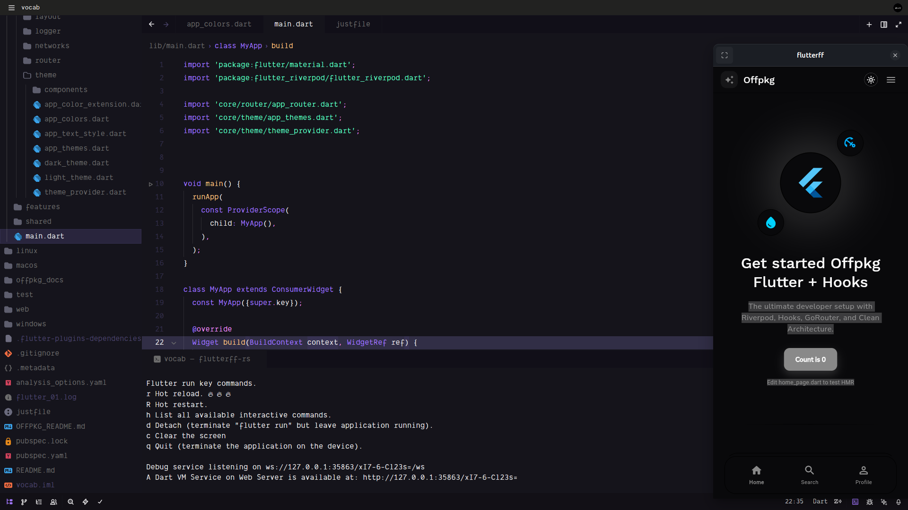
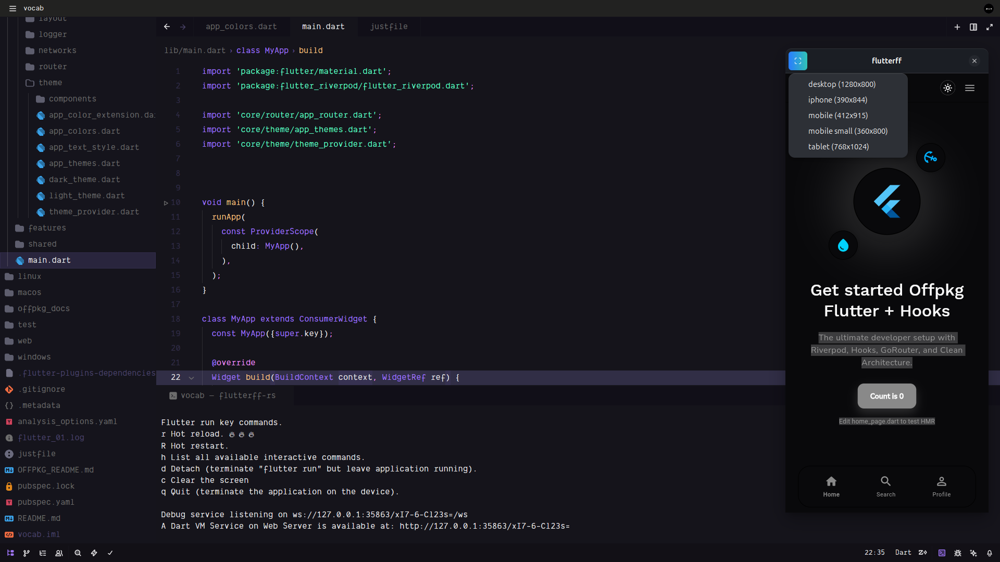

<div align="center">


# `flutterff-rs`

**A lightweight, terminal-first Flutter Web development launcher & native mobile simulator for Linux.**  
*Native GTK3 + WebKit2GTK viewport · 24-bit `cargo-pretty` live terminal TUI · Zero Chrome overhead.*

[](CHANGELOG.md)
[-027DFD?style=flat-square&logo=rust&logoColor=white&labelColor=1E1E2E)](Cargo.toml)
[-50FA7B?style=flat-square&logo=linux&logoColor=white&labelColor=1E1E2E)](#)
[](DESIGN.md)
[](#)

</div>

---

## ⚡ Why `flutterff-rs`?

Launching a full Chromium instance or Android Emulator for Flutter UI iteration consumes gigabytes of RAM and clutters your workspace with browser chrome. **`flutterff-rs`** orchestrates `flutter run -d web-server` in a background thread and renders your app inside a minimal, chromeless **GTK3 + WebKit2GTK** window tailored to mobile, tablet, and desktop presets—paired with a 20 FPS **[`cargo-pretty`](https://github.com/romancitodev/cargo-pretty)**-style terminal UI.

| Capability | Chrome / Standard Web | `flutterff-rs` v2.5.4 |
| :--- | :--- | :--- |
| **Memory Footprint** | 800 MB – 2.5 GB+ | **Minimal (`WebKit2GTK` `DocumentViewer` cache)** |
| **Window Chrome** | Tabs, omnibox, bookmarks bar | **Single minimal GTK3 `HeaderBar` (`menu:close`)** |
| **Device Switching** | Open DevTools → Responsive mode | **1-click native GTK popup (`mobile`, `iphone`, `tablet`, etc.)** |
| **Hot Reload / Restart** | Terminal focus required | **Built-in `🗲` (Reload) & `🔄` (Crash-safe Restart) header buttons** |
| **Screenshots** | Manual crop / Wayland issues | **1-click Cairo `ARgb32` surface snapshot → `screenshots/`** |
| **Terminal Output** | Noisy DDC / bootstrap logs | **24-bit Truecolor `cargo-pretty` live TUI + filtered `INF`/`WRN`/`ERR` stream** |

---

## 📸 Visual Preview

<div align="center">

| Native GTK3 Mobile Shell | Instant Device Preset Switcher |
| :---: | :---: |
|  |  |

</div>

### Live Terminal TUI (`cargo-pretty` × `flutterff-rs` Theme)

During both local compilation (`./localinstall.sh` / `./localupdate.sh`) and `flutterff-rs` startup, the terminal renders a 20 FPS inline status view with RGB alpha-fading rows, per-step timers, and a sweeping Cyan-Blue-Mint progress ramp before settling into a clean summary card:

```text
🦊 flutterff-rs v2.5.4
flutter run -d web-server --web-port=8080
────────────────────────────────────────
Building
● compile lib/main.dart (web)     03.42s
● bind http://localhost:8080      00.85s


────────────────────────────────────────
Completed (3/5)

✓ network check (online)          00.03s
✓ gtk3 + webkit2 shell (412×915)  00.07s
✓ flutter web-server daemon       00.54s

Launching     ████████████████░░░░░░░░░░░░   60%
Elapsed       04.32s
```

Once the local socket accepts connections, the live view settles into:

```text
✓ flutterff-rs v2.5.4 serving in 4.86s
  window         412×915 (mobile)
  server         http://localhost:8080
  mode           debug · online
────────────────────────────────────────
19:45:02 INF App initialized
19:45:10 HOT reload
19:45:14 WIN iphone (390×844)
19:45:18 SCR saved → screenshots/screenshot_20261107_194518.png (390×844)
```

---

## 🎨 Semantic Design System ([`DESIGN.md`](DESIGN.md))

Structured following the **[VoltAgent/awesome-design-md](https://github.com/VoltAgent/awesome-design-md)** and Google Stitch `DESIGN.md` specification so coding and design agents can reproduce the exact visual language:

| Token | Name | Hex / RGB | Role in `flutterff-rs` |
| :--- | :--- | :--- | :--- |
| `colors.primary` | **Electric Cyan** | `#00E5FF` `(0, 229, 255)` | Brand identity, active `●` indicator, `HOT`/`WIN` badges, server URL |
| `colors.secondary` | **Flutter Blue** | `#027DFD` `(2, 125, 253)` | Progress bar outer gradient stop |
| `colors.sapphire` | **Sky Sapphire** | `#38BDF8` `(56, 189, 248)` | Active step highlight & `INF` log badge |
| `colors.accent-mint` | **Aqua Mint** | `#72EFDD` `(114, 239, 221)` | Mid-ramp progress bar highlight |
| `colors.success` | **Neon Mint** | `#50FA7B` `(80, 250, 123)` | Completed `✓` indicator, settled bar, `SCR` badge |
| `colors.warning` | **Warm Amber** | `#F9E2AF` `(249, 226, 175)` | Compiler warning badge & `WRN` log level |
| `colors.danger` | **Coral Rose** | `#F38BA8` `(243, 139, 168)` | Build/runtime error `✗` & `ERR` log level |
| `colors.ink` | **Lavender Ink** | `#CDD6F4` `(205, 214, 244)` | Primary terminal copy & log output |
| `colors.subtext` | **Muted Slate** | `#A6ADC8` `(166, 173, 200)` | Live `00.00s` timers & viewport dimensions |
| `colors.dim` | **Dim Graphite** | `#6C7086` `(108, 112, 134)` | 40-char `─` dividers, section labels, `HH:MM:SS` timestamps |
| `colors.surface` | **Charcoal Surface** | `#45475A` `(69, 71, 90)` | Unfilled `░` cells of the 28-cell progress bar |
| `colors.canvas` | **Obsidian Base** | `#1E1E2E` `(30, 30, 46)` | Target background for `blend(fg, BASE, alpha)` row fading |

> See the full machine- and LLM-readable design specification in **[`DESIGN.md`](DESIGN.md)**.

---

## 🏗️ Architecture & Technical Highlights

1. **Subprocess & Stream Orchestration (`run_flutter`)**:
   - Spawns `flutter run -d web-server --web-port=<port>` with piped `stdin`, `stdout`, and `stderr`.
   - Automatically scans for a free TCP port (`8080..8200`) if the requested port is in use.
   - Auto-detects offline status via a fast 2-second socket probe (`8.8.8.8:53`) and injects `--no-pub --no-web-resources-cdn` when offline.
2. **Native GTK3 + WebKit2 Shell**:
   - Uses `CacheModel::DocumentViewer` to keep memory consumption low.
   - Injects a document-start `UserScript` that bridges `console.log/warn/error/info/debug` to Rust via `window.webkit.messageHandlers.flutterLog`, stripping noisy DDC/bootstrap stack frames.
3. **Wayland-Safe Cairo Screenshot Capture (`take_screenshot`)**:
   - Bypasses WebKit's Wayland snapshot limitations by rendering the `WebView` GTK allocation directly onto a `cairo::ImageSurface` (`Format::ARgb32`) and writing lossless PNGs to `./screenshots/`.
4. **Crash-Safe Hot Restart**:
   - Sending raw `R` to `flutter run -d web-server` can trigger `"surface instance already deleted"` crashes. `flutterff-rs` filters that noise and executes a clean WebView URI reload to trigger a fresh state rebuild safely.

---

## 🛠️ Installation & Local Scripts

### Prerequisites

- **Rust**: `rustc 1.99+` (Edition 2024) via [rustup.rs](https://rustup.rs/)
- **Flutter**: `flutter` CLI available in your `PATH`
- **GTK3 & WebKit2GTK Development Libraries**:
  - **Ubuntu / Debian**: `sudo apt install libgtk-3-dev libwebkit2gtk-4.1-dev`
  - **Arch Linux**: `sudo pacman -S gtk3 webkit2gtk-4.1`
  - **Fedora**: `sudo dnf install gtk3-devel webkit2gtk4.1-devel`

### Build & Install (`-j 1` Configured)

All Cargo operations in this repository are configured in `.cargo/config.toml` to run with **`jobs = 1` (`-j 1`)** for deterministic, low-contention compilation:

```bash
# First-time local check, build (-j 1), and install to ~/.local/bin/flutterff-rs
chmod +x localinstall.sh
./localinstall.sh

# Rebuild (-j 1) with backup (~/.local/bin/flutterff-rs.bak) after local edits
./localupdate.sh
```

*(Note: `localinstall.sh` and `localupdate.sh` are listed in `.gitignore` so machine-specific installer tweaks stay local.)*

---

## 📖 CLI Usage & Presets

Run `flutterff-rs` from the root of any Flutter project:

```bash
flutterff-rs [OPTIONS]
```

| **Flag** | **Short** | **Description** |
| :--- | :--- | :--- |
| `--mcp` / `mcp` | | **Run as a native Model Context Protocol (MCP) JSON-RPC server over `stdio`.** |
| `--size <PRESET\|WxH>` | `-s` | Set viewport size (`mobile`, `mobile-small`, `iphone`, `tablet`, `desktop`, or `WxH` e.g. `430x932`). |
| `--port <PORT>` | `-p` | Set starting `web-server` HTTP port (default: `8080`, auto-increments if busy). |
| `--offline` | | Force offline mode (`--no-pub --no-web-resources-cdn`). |
| `--profile` | | Run Flutter in `--profile` mode for performance analysis. |
| `--flavor <NAME>` | | Pass a custom `--flavor` to Flutter. |
| `--no-hot` | | Disable hot reload support. |
| `--list-sizes` | | Display all built-in device size presets and dimensions. |
| `--version` | `-V` | Print `flutterff-rs` version (`v2.5.4`). |
| `--help` | `-h` | Print CLI help information. |

---

## 🤖 Native Rust MCP Server (`flutterff-rs --mcp`)

`flutterff-rs` includes a **zero-dependency, ultra-lightweight Rust-native MCP server** (`src/mcp.rs`) that bridges AI coding agents (Claude Code, Cursor, Antigravity, Windsurf, Zed) directly to the live GTK3 + WebKit2 simulator window over a local Unix domain socket (`$XDG_RUNTIME_DIR/flutterff-rs.sock`).

### MCP Configuration (`mcp_config.json` / `.mcp.json`)

```json
{
  "mcpServers": {
    "flutterff": {
      "command": "flutterff-rs",
      "args": ["--mcp"]
    }
  }
}
```

### Exposed MCP Tools & Resources

| MCP Tool / Resource | Description |
| :--- | :--- |
| **`flutter_status`** | Returns live JSON status (running state, URL, port, window size, `pointer_mode`, mode, log count). |
| **`flutter_launch`** | Spawns a new `flutterff-rs` simulator window (`project_dir`, `size`, `port`, `offline`, `profile`, `flavor`). |
| **`flutter_ui_tree`** | **[`page-agent`](https://github.com/alibaba/page-agent)-style Semantics & DOM Inspector**: Auto-enables Flutter Web semantics and returns indexed interactive widgets (`[0]`, `[1]`, `[2]...`) with roles, labels, values, and `(x, y)` coordinates. |
| **`flutter_tap`** | Taps/clicks a Flutter widget by **`index`** (`[0]`), **`text`/label** (`"Sign In"`), or **`(x, y)` coordinates**. Uses a **Red-Orange Mobile Touch Dot (`●`) + touch events** on mobile/tablet viewports and a **Red-Orange `Bibata-Modern-Ice` Desktop Cursor (`↖`) + mouse events** on desktop viewports. |
| **`flutter_type`** | Types text into a Flutter `TextField` or input (`text`, optional `index` or `target_text` to tap/focus first, `clear`, and `submit`). |
| **`flutter_scroll`** | Scrolls or swipes the viewport or an indexed scrollable widget (`dx`, `dy`, `index`, `x`, `y`) with animated touch drag or wheel motion. |
| **`flutter_press_key`** | Dispatches keyboard events (`Enter`, `Escape`, `Backspace`, `Tab`, `ArrowDown`, etc.) to the active Flutter widget. |
| **`flutter_inspect_overlay`** | Toggles the visual `[0]`, `[1]` Set-of-Mark bounding-box overlay and configures `pointer_mode` (`"auto"`, `"cursor"`, `"touch"`). |
| **`flutter_hot_reload`** | Injects `'r'` into the running Flutter daemon for instant Hot Reload. |
| **`flutter_hot_restart`** | Triggers a crash-safe WebView Hot Restart. |
| **`flutter_resize`** | Dynamically resizes the GTK window to any preset (`mobile`, `iphone`, `tablet`, `desktop`) or custom `WxH` and auto-switches `pointer_mode`. |
| **`flutter_screenshot`** | Captures a native Cairo `ARgb32` PNG snapshot (`screenshots/screenshot_*.png`) and returns inline base64 `image/png` content. |
| **`flutter_logs`** | Reads recent filtered Flutter & WebView logs (`INF`, `WRN`, `ERR`, `DBG`) with optional `limit`, `level`, and `clear`. |
| **`flutter_eval_js`** | Evaluates arbitrary JavaScript inside the live WebKit2 WebView and returns the evaluated result synchronously. |
| **`flutter_stop`** | Gracefully stops the Flutter daemon (`'q'`) and closes the simulator window. |
| **`flutterff://status` · `flutterff://ui_tree` · `flutterff://logs` · `flutterff://presets`** | Built-in MCP Resources for querying live simulator state, indexed UI tree, logs, and viewport presets. |

### Built-in Device Presets & Adaptive Pointer Mode

| Preset Name | Dimensions (`W×H`) | Pointer Mode | Target Form Factor |
| :--- | :--- | :--- | :--- |
| **`mobile`** *(default)* | `412 × 915` | **`touch`** *(Red-Orange Touch Dot `●` + Touch Events)* | Modern Android flagship portrait |
| **`mobile-small`** | `360 × 800` | **`touch`** *(Red-Orange Touch Dot `●` + Touch Events)* | Compact Android portrait |
| **`iphone`** | `390 × 844` | **`touch`** *(Red-Orange Touch Dot `●` + Touch Events)* | iPhone 13 / 14 portrait |
| **`tablet`** | `768 × 1024` | **`touch`** *(Red-Orange Touch Dot `●` + Touch Events)* | iPad / Tablet portrait |
| **`desktop`** | `1280 × 800` | **`cursor`** *(Red-Orange `Bibata` Arrow `↖` + Mouse Events)* | Widescreen desktop / Web layout |

---

## 📂 Repository Layout

- **[`Cargo.toml`](Cargo.toml)** — Package manifest (`v2.5.4`, Rust Edition `2024`, `gtk 0.18.2`, `webkit2gtk 2.0.2`, `glib 0.18.5`, `cairo-rs 0.18.5`, `chrono 0.4.45` — zero `regex` dependency).
- **[`.cargo/config.toml`](.cargo/config.toml)** — Enforces single-job (`jobs = 1` / `-j 1`) Cargo builds and checks.
- **[`src/main.rs`](src/main.rs)** — Core launcher, GTK3/WebKit2 window shell, Cairo screenshot engine, local Unix IPC bridge, and `cargo-pretty` terminal TUI.
- **[`src/mcp.rs`](src/mcp.rs)** — Zero-dependency native Rust Model Context Protocol (MCP) JSON-RPC 2.0 server, minimal JSON parser/serializer, and base64 PNG encoder.
- **[`src/agent_bridge.js`](src/agent_bridge.js)** — In-page GUI agent & Flutter Semantics inspector (inspired by [`alibaba/page-agent`](https://github.com/alibaba/page-agent)) with adaptive desktop cursor (`↖`) and mobile touch dot (`●`) overlays.
- **[`DESIGN.md`](DESIGN.md)** — Semantic design system specification ([VoltAgent/awesome-design-md](https://github.com/VoltAgent/awesome-design-md) format).
- **[`CHANGELOG.md`](CHANGELOG.md)** — Version history and release notes.
- **[`docs/`](docs/)** — Detailed guides on [architecture](docs/architecture.md), [dependencies](docs/modifications_and_packages.md), [installation](docs/setup_and_installation.md), and [usage](docs/usage_and_examples.md).

---

<div align="center">
  Built with 🦀 <strong>Rust (Edition 2024)</strong> & 💙 <strong>Flutter</strong>
</div>
